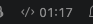
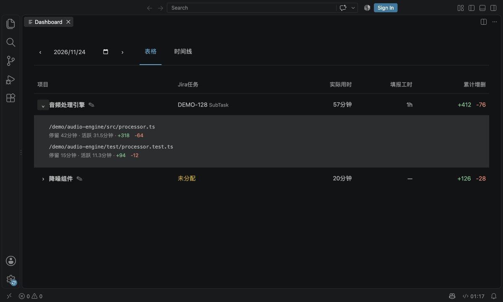
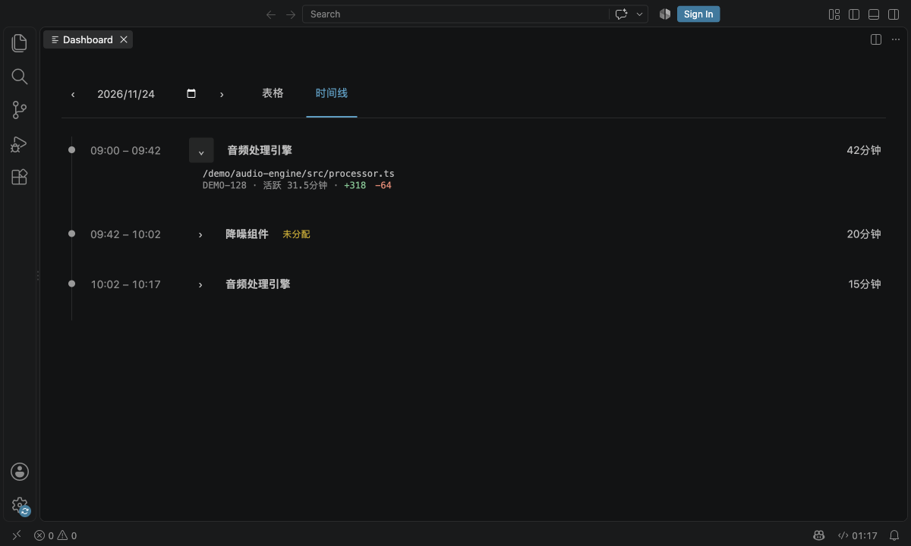

# Dashboard 使用指南

在 VS Code 中自动记录代码文件的停留时间和编辑量，按项目查看每天的工作记录。

## 1. 安装并开始记录

1. 在 VS Code 扩展面板搜索 `YuanhaoLiu.dashboard-simple-code-time-tracker`，或打开 [扩展商店页面](https://marketplace.visualstudio.com/items?itemName=YuanhaoLiu.dashboard-simple-code-time-tracker) 点击安装。
2. 打开项目中的代码文件，正常阅读和编辑即可自动记录，无需手动开始或停止。
3. 点击右下角的代码图标与时间，打开 Dashboard。也可以在命令面板运行 `Dashboard: Open`。

状态栏显示今天所有项目累计的实际停留时间，格式为 **小时:分钟**：`00:03` 表示 3 分钟，`01:17` 表示 1 小时 17 分钟。每 10 秒更新，跨日重新累计。

## 2. 查看某一天的统计

在页面上方选择日期，或点击左右箭头切换前一天、后一天。切换报表日期时，右下角状态栏仍显示今天的累计时间。

点击 **表格**，查看每个项目的实际用时、填报工时和累计增删。点击项目左侧的箭头，展开文件路径和每个文件的明细。

- **实际用时**：代码文件在前台停留的时间，包含静止阅读；切到其他应用、终端或 Dashboard 时停止累计。
- **活跃时间**：展开文件后可见，表示近期有输入、选择或滚动操作的时间。
- **累计增删**：累计新增和删除的字符数，包含未保存编辑和撤销操作，并非 Git 差异。
- **填报工时**：关联 Jira 任务后，将当天同一任务的用时合并，按 0.5 小时四舍五入显示，填写工时时请先核对。多个项目关联同一任务时，合计只在首行显示。

点击 **时间线**，按时间顺序查看工作记录；点击每条记录左侧的箭头，展开文件路径、关联任务和编辑量。

以上为本机 VS Code 实际截图，页面中的项目、任务和时长为演示数据。

## 3. 修改项目名称和关联 Jira

- **改名**：在表格中点击项目名称旁的铅笔，输入名称后按回车。这里只修改显示名称，不会重命名项目文件夹。
- **关联任务**：点击“Jira 任务”列中的“未分配”或已有任务号，输入如 `DEMO-128` 的任务号，再选择 `Task` 或 `SubTask`。若任务有子任务，请填写具体子任务号。
- **取消关联**：再次点击任务号，清空输入并确认。

任务关联对该项目全部历史记录生效。插件不会连接 Jira，也不会自动提交工时。

## 4. 调整空闲时间

打开 VS Code 设置，搜索 `dashboard.idleMinutes`，设置 1–60 分钟，默认 5 分钟。

超过这个时间没有输入、选择或滚动操作时，停止累计“活跃时间”；只要代码文件仍在前台，静止阅读仍会计入“实际用时”。
